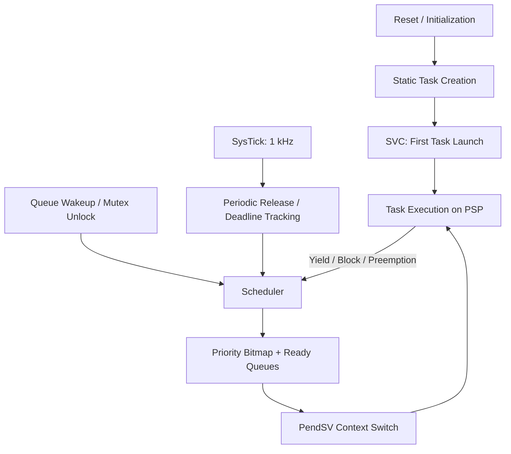

# Preemptive RTOS for Cortex-M4

This project implements a compact, bare-metal RTOS for the STM32F446RE
(ARM Cortex-M4F) using freestanding C and ARM Thumb-2 assembly.
It demonstrates the mechanisms behind a fixed-priority preemptive kernel:
exception-driven context switching, deterministic resource bounds, interrupt-safe
state transitions, priority inheritance, and cycle-level timing measurement.

The kernel targets the ST NUCLEO-F446RE without a vendor HAL,
dynamic allocation, libc runtime dependency, or another RTOS.
It favors small, auditable resource bounds over broad API coverage.

## Architecture



Tasks run in Thread mode on caller-provided PSP stacks; exceptions run on MSP.
SVC restores the first task, while lowest-priority PendSV saves and restores R4-R11
around the C scheduler ([context_switch.S](arch/cortex_m4/context_switch.S)). The
target uses an integer-only `0xFFFFFFFD` exception return path. Although the MCU
contains an FPU, the current soft-float build does not support floating-point task
contexts.

The scheduler maintains one FIFO ready queue per priority and a 32-bit bitmap.
`CLZ` selects the highest-priority nonempty queue in O(1); equal-priority tasks keep
FIFO order ([scheduler.c](kernel/scheduler.c)). O(1) applies to ready-task selection,
not message copies, wait-list reordering, priority-inheritance propagation, or the
bounded periodic-task scan.

| Directory | Responsibility |
|---|---|
| [`startup/`](startup/startup_stm32f446re.S), [`linker/`](linker/stm32f446re.ld) | Vector/reset initialization and STM32F446RET6 Flash/SRAM layout |
| [`arch/cortex_m4/`](arch/cortex_m4/port.c) | Initial frames, SVC/PendSV, PSP switching, BASEPRI, DWT counter, faults |
| [`kernel/`](kernel/scheduler.c) | Tasks, scheduler, periodic timing/deadlines, queues, PI mutexes, monitor |
| [`include/aerortos/`](include/aerortos/task.h) | Public kernel, port, and minimal device-register contracts |
| [`bsp/stm32f446/`](bsp/stm32f446/clock.c) | 16 MHz HSI clock, 1 kHz SysTick, NUCLEO LD2 support |
| [`app/`](app/main.c) | Minimal periodic demonstration image |
| [`tests/`](tests/integration_test.c) | Host regressions and isolated STM32 hardware acceptance tests |

## Key implementation details

- **Static resources:** eight TCB slots, 32 priorities, caller-owned stacks, queue
  buffers, mutexes, and fixed timing buffers. Capacity exhaustion is explicit;
  kernel code performs no dynamic allocation.
- **Critical sections:** nested `BASEPRI` masking at `0x40` protects kernel-aware
  state while preserving more urgent interrupts. Prior `BASEPRI` state is restored;
  SVC uses priority `0x20` and PendSV `0xF0`
  ([critical_section.c](arch/cortex_m4/critical_section.c)).
- **Periodic work:** a 1 kHz SysTick scans at most eight registered periodic tasks.
  Absolute `next_release += period` phase progression and signed-difference ordering
  are safe across 32-bit tick wrap within the documented half-range. Each task has
  one active job; late releases are skipped and counted instead of queued as backlog
  ([timer.c](kernel/timer.c), [deadline.c](kernel/deadline.c)).
- **Deadline accounting:** releases, starts, execution ticks, completion, misses,
  overruns, skipped releases, and release jitter are bounded per task. A miss is
  counted once only when an active job is observed strictly after its deadline.
- **Message queues:** caller-owned fixed-capacity FIFOs provide nonblocking and
  indefinite blocking operations. Ring updates are O(1), payload copies are
  O(element size), and priority/FIFO waiter scans are bounded by eight tasks
  ([queue.c](kernel/queue.c)).
- **Mutexes:** non-recursive, owner-only unlock with bounded transitive priority
  inheritance, restoration across multiple owned mutexes, queue-waiter reordering,
  and acquisition-cycle rejection. PI mitigates inversion; it does not by itself
  prove an application blocking-time bound ([mutex.c](kernel/mutex.c)).
- **Diagnostics:** stack guards/high-water scans, scheduler/queue/mutex invariants,
  deadline counters, and opt-in DWT instrumentation use statically bounded storage
  ([monitor.c](kernel/monitor.c), [cycle_counter.c](arch/cortex_m4/cycle_counter.c)).

## Hardware validation and benchmarks

The kernel was validated on an STM32F446RE at 16 MHz using isolated hardware
tests covering context switching, scheduling, interrupt masking, periodic execution,
message queues, mutexes, and timing instrumentation. Acceptance results were
reproduced after debugger reset.

### Scheduling and context-switch timing

These measurements were collected from the initial hardware-verified
instrumented firmware at 16 MHz. Mean cycle counts are calculated
from the recorded total cycles and sample counts.

| Metric | Samples | Measurement boundary | Mean (cycles / µs) | Observed max (cycles / µs) |
|---|---:|---|---:|---:|
| PendSV software overhead | 42 | First DWT read at PendSV entry to post-restore/PSP-update hook before `EXC_RETURN` | 446.95 / 27.93 | 491 / 30.69 |
| READY-to-dispatch | 28 | Task becomes READY to selected-task pre-`EXC_RETURN` hook | 1,274.54 / 79.66 | 3,515 / 219.69 |
| Periodic release-to-dispatch | 8 | SysTick records actual release to selected-task pre-`EXC_RETURN` hook | 885.25 / 55.33 | 886 / 55.38 |
| Synchronization wake-to-dispatch | 2 | Queue/mutex waiter removal immediately before wake to selected-task pre-`EXC_RETURN` hook | 2,300 / 143.75 | 3,702 / 231.38 |

Synchronization wakeup latency was measured from only two events and should
not be interpreted as a representative latency distribution.

### Critical-section timing (revised monitor)

The corrected final image completed with magic `0x4D313041`, **80/80 assertions
passed, 0 failed**, six completed participants, and one deliberate deadline miss.
Results reproduced identically after debugger reset.

| Observations | Raw retained / dropped | Boundary | Minimum | Mean | Observed max |
|---:|---:|---|---:|---:|---:|
| 104 | 64 / 40 | Outermost monitored entry after masking to immediately before prior-`BASEPRI` restoration | 80 cycles / 5.00 µs | 222.70 cycles / 13.92 µs | 916 cycles / 57.25 µs |

All 104 observations contributed to the 23,161-cycle total, count, minimum,
maximum, and mean. The 64/40 split describes bounded raw-sample retention, not loss
from aggregate statistics. The other timing distributions above were not rerun on
this final firmware.

The original firmware measured 9 cycles (0.5625 µs) between back-to-back DWT
timestamp reads. This characterizes timestamp access only; it is **not** the total
cost of monitor hooks, state bookkeeping, scheduler calls, or other instrumentation.

Instrumentation is compile-time opt-in and changes the measured firmware. PendSV
timing excludes hardware exception entry and return, while dispatch measurements
stop just before exception return rather than at the first task instruction. DWT
subtraction is wrap-safe for intervals shorter than one 32-bit counter wrap
(approximately 268 seconds at 16 MHz). These are workload-specific observed
distributions; an observed maximum is **not** a formally proven WCET bound.

## Reference benchmarks

UL Solutions published the following RTOSBench results on an STM32F429ZIT6 using
FreeRTOS 10.4.4 and Zephyr 2.6.0. Each reported value is the average of 1,000 runs.
The RTOSBench context-switch boundary is from one cooperative task voluntarily
yielding until the next task executes. The test used a 20 Hz tick with assertions
disabled; Zephyr also disabled tickless mode, power management, hardware stack
protection, and coverage while enabling its timing and dynamic-interrupt support.

| System | Hardware / configuration | Context-switch mean | Boundary and source |
|---|---|---:|---|
| FreeRTOS 10.4.4 | STM32F429ZIT6, RTOSBench, 1,000 runs | 223 cycles | Cooperative yield to next-task execution; [UL Solutions report](https://www.ul.com/sis/blog/measuring-real-time-operating-system-performance-part-ii-comparing-freertos-vs-zephyr) |
| Zephyr 2.6.0 | STM32F429ZIT6, RTOSBench, 1,000 runs | 524 cycles | Cooperative yield to next-task execution; [UL Solutions report](https://www.ul.com/sis/blog/measuring-real-time-operating-system-performance-part-ii-comparing-freertos-vs-zephyr) |

These published values are provided as references, separate from the measurements above.
The custom kernel uses a different STM32, firmware configuration, and measurement boundary:
its PendSV interval excludes hardware exception entry/return and does not extend to
the first resumed task instruction. RTOSBench measures an end-to-end cooperative
yield. Compiler/build conditions and instrumentation also differ, so the results
**cannot establish a performance ranking**. See UL's [RTOSBench methodology and
porting notes](https://www.ul.com/sis/blog/measuring-real-time-operating-system-performance-part-i-finding-and-porting-benchmark).

## Build and run

Requirements: GNU Arm Embedded toolchain (`arm-none-eabi-*`), GNU Make, a host C
compiler for portable tests, and OpenOCD plus ST-Link hardware for target use.

```sh
make clean && make all     # build build/aerortos.{elf,bin,map}
make test                  # eight host regression executables
make test-sanitize         # ASan/UBSan host suite
make verify                # host tests plus ELF/vector/symbol/assembly checks
```

The verified default, uninstrumented application image is 4,088 bytes of text,
8 bytes of data, and 3,596 bytes of BSS. This is the complete linked firmware image,
not a kernel-only footprint.

Flash and debug the default image:

```sh
make flash
make openocd               # terminal 1
make gdb GDB=gdb-multiarch # terminal 2, override only if needed
```

Build or reproduce the isolated timing acceptance image:

```sh
make m10-hardware-test
make flash-m10-test
make openocd                         # terminal 1
make gdb-m10-test GDB=gdb-multiarch # terminal 2
```

Hardware runs used the NUCLEO board's onboard ST-LINK with OpenOCD configurations
`interface/stlink.cfg` and `target/stm32f4x.cfg`. The flash target starts a temporary
OpenOCD process and exits; interactive debugging requires one persistent
`make openocd` server and GDB in a second terminal on port 3333. Use an ARM-capable
GDB such as `gdb-multiarch` when `arm-none-eabi-gdb` is unavailable, and use
`monitor reset halt` plus the stable completion-marker breakpoint for reset-repeat
checks.

## Limitations and future work

- Fixed eight-task capacity, 32 priorities, 1 ms release/deadline granularity, and
  integer-only task contexts are deliberate current bounds.
- Queue and mutex waits are indefinite; there are no timeout, cancellation,
  deletion, recursive-mutex, task-deletion, SMP, MPU isolation, or tickless APIs.
- Hardware validation is engineering evidence for the stated board and scenarios,
  not safety certification or a universal hard-real-time guarantee.
- A representative flight-control workload and extended overload/IRQ/IPC stress
  campaign are optional future work; they are not implemented project features.
